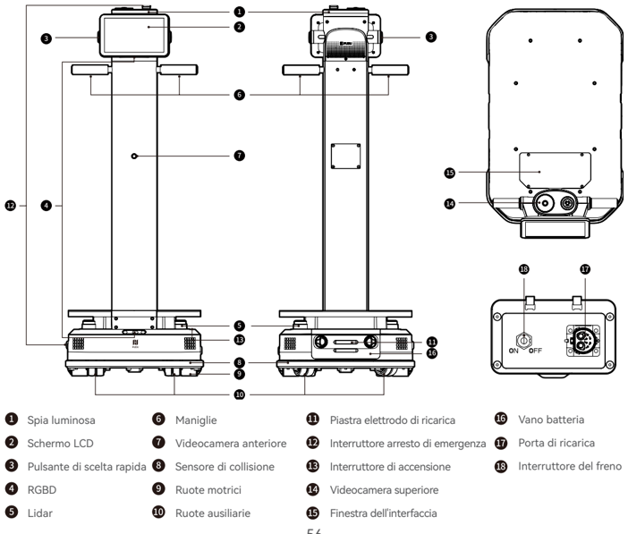
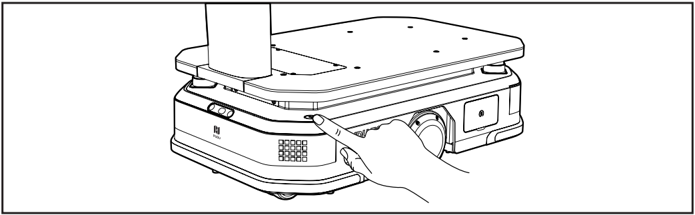
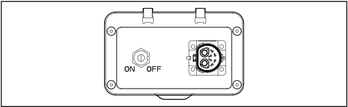
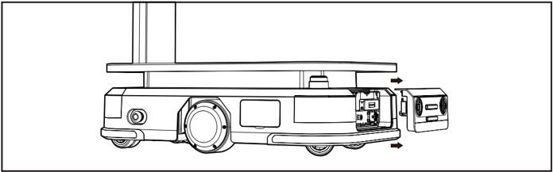
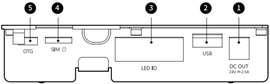

*Pagina 55 (pagina PDF 30, sinistra)*

## Copyright © 2024 Shenzhen Pudu Technology Co., Ltd. Tutti i diritti riservati.

Non è consentito ad alcuna organizzazione o individuo imitare, copiare, trascrivere o tradurre i contenuti di questa guida per l'utente, in tutto o in parte, senza il consenso scritto esplicito di Shenzhen Pudu Technology Co., Ltd., né di distribuirla a scopo di lucro in qualsivoglia modo (elettronicamente o tramite fotocopiatura, registrazione, ecc.). Le specifiche del prodotto e le informazioni fornite nelle presenti istruzioni per l'uso hanno solo scopo di riferimento e sono soggette a variazione senza ulteriore preavviso. Salvo diversa indicazione, questa guida per l'utente è destinata unicamente a fornire istruzioni per l'utilizzo, e nessuna affermazione in esse contenuta dovrà essere considerata come una garanzia di qualsiasi tipo.

# 1. Istruzioni per la sicurezza

## 1.1 Requisiti elettrici

- È strettamente vietato usare caricatori diversi dall'originale per ricaricare il robot. Se il caricatore risulta difettoso, sostituirlo il prima possibile.
- Caricare completamente la batteria al 100% prima del primo utilizzo.
- Accertarsi di ricaricare il robot non appena la carica residua è inferiore al 20%. Lavorare con livelli di carica bassi per lunghi periodi di tempo ridurrà la durata della batteria.
- Accertarsi che la tensione di alimentazione corrisponda all'intervallo di tensione del caricatore, altrimenti il caricatore potrebbe danneggiarsi.
- Per evitare danni, non far cadere il caricatore né urtarlo con oggetti estranei.
- Smaltire la batteria secondo le normative locali e non smaltirla tra i rifiuti domestici. Una manipolazione impropria può causare l'esplosione della batteria.

## 1.2 Requisiti di utilizzo

- Non bloccare il sensore del robot. In caso contrario, il robot potrebbe non muoversi in modo corretto o perdere l'orientamento.
- Sono vietati interventi di pulizia o manutenzione mentre il robot è acceso.
- Non posizionare sul robot fornelli con fiamme libere o oggetti infiammabili o esplosivi.
- Non prelevare o posizionare oggetti mentre il robot è in movimento, per evitare danni alle proprietà o lesioni personali causate da collisioni accidentali.
- Non spingere o trasportare il robot mentre è in movimento, per evitare che funzioni in modo anomalo.
- Il robot non deve essere smontato o riparato da nessuno che non sia un professionista qualificato. In caso di guasti al robot, contattare immediatamente un tecnico dell'assistenza.
- Qualora sia necessario spostare il robot, rispettare i requisiti relativi al peso massimo consentito per una singola persona stabiliti dalle leggi e dai regolamenti locali. Durante lo spostamento del robot, assicurarsi di tenerlo sempre in posizione verticale.
- Per evitare inutili pericoli, non è consentito giocare di fronte al robot quando esso è in movimento.
- Sebbene il robot sia dotato di un sistema automatico di aggiramento degli ostacoli, non bloccarlo mai mentre si muove ad alta velocità per evitare incidenti.
- Evitare urti o colpi violenti al robot per evitare danni.
- Non pulire il robot con prodotti chimici o detergenti caustici. Pulire sempre il robot con un panno pulito e asciutto.

## 1.3 Requisiti ambientali

- Per evitare lesioni personali o danni al prodotto, non utilizzare o caricare il robot in ambienti pericolosi con alte temperature, alta pressione o rischi di fiamme o esplosioni.
- Per evitare di danneggiare il robot, non utilizzarlo in ambienti umidi o in presenza di sostanze liquide o viscose sul pavimento.
- Non utilizzare il robot in luoghi in cui l'uso di dispositivi wireless sia espressamente vietato, poiché potrebbe interferire con altri dispositivi elettronici o causare altri pericoli.

---

*Pagina 56 (pagina PDF 30, destra)*

- Per evitare danni al robot, non utilizzarlo in un ambiente umido o su superfici ricoperte di liquidi o sostanze appiccicose.
- Il robot è adatto all'uso su suolo piano. Non utilizzarlo in ambienti con gradini o pendii ripidi.
- È necessario utilizzare il robot nell'ambiente operativo del prodotto dichiarato nel presente manuale. In caso contrario, potrebbero verificarsi anomalie di funzionamento dell'apparecchiatura o altri pericoli.
- Non smaltire il robot o i suoi accessori come rifiuti domestici. Rispettare le normative locali relative allo smaltimento del robot e dei suoi accessori e di sostenere il riciclaggio.

# 2. Componenti del prodotto

## 2.1 Panoramica

PUDU T300 è un robot di consegna utilizzato per il trasferimento di materiali in ambienti industriali e per la movimentazione di carichi di grandi dimensioni in ambienti commerciali. È dotato di un telaio di carico come elemento centrale e di uno schermo operativo per un utilizzo intuitivo. Il carico massimo del robot può raggiungere i 300 kg. Lo spazio di carico è aperto e flessibile e può essere abbinato a diversi accessori per soddisfare diverse esigenze di trasporto. Dispone inoltre di interfacce avanzate, utili per l'espansione hardware e l'interconnessione IoT.

## 2.2 Contenuto della confezione

Robot ×1, Manuale utente PUDU T300 ×1, Certificato di qualità ×1, Caricatore ×1.

## 2.3 Aspetto e componenti

*Etichette:*

- Vano batteria
- Spia luminosa
- Maniglie
- Piastra elettrodo di ricarica
- Porta di ricarica
- Schermo LCD
- Videocamera anteriore
- Interruttore arresto di emergenza
- Interruttore del freno
- Pulsante di scelta rapida
- Sensore di collisione
- Interruttore di accensione
- RGBD
- Ruote motrici
- Videocamera superiore
- Lidar
- Ruote ausiliarie
- Finestra dell'interfaccia

---

*Pagina 57 (pagina PDF 31, sinistra)*

## 2.4 Specifiche tecniche

| Funzionalità del prodotto | Descrizione |
|---|---|
| Tensione di lavoro | 20,8 V~29,2 V CC |
| Capacità della batteria | 30 Ah |
| Carico massimo | 300 kg |
| Tempo di carica | Circa 2 ore (da 0% a 90%) |
| Durata della batteria | 12 h (senza carico); 6 h (carico massimo) |
| Peso complessivo | 65 kg (WTID01); 81 kg (WTIDL1) |
| Dimensioni complessive | 835 × 500 × 1350 millimetri |
| Dimensioni del telaio | 780 × 500 × 240 mm |
| Velocità di crociera | 0,2-1,2 m/s (regolabile) |
| Metodo di navigazione | SLAM visivo, SLAM laser |
| Minimo distanziamento del percorso | 60 cm |
| Massima altezza superabile | 20 mm |
| Massimo spazio superabile | 35 mm |
| Sistema operativo | Android |
| Potenza dell'altoparlante | Altoparlante stereo da 10 W × 2 |
| Ambiente di lavoro | Temperatura: da 0 ° C a 40 ° C; umidità relativa: ≤ 85% |
| Ambiente di conservazione | Temperatura: da -20 ° C a 60 ° C; umidità relativa: ≤ 85% |
| Altitudine di lavoro | < 2000 m |
| Requisiti della superficie stradale | Ambiente interno con superfici piane e lisce |
| Ingresso alimentazione caricatore | 100 VCA - 240 VCA, 50/60 Hz |
| Potenza di uscita del caricatore | 29,2 V, 15 A |

# 3. Istruzioni del prodotto

## 3.1 Descrizione dei pulsanti

## Accensione:

Spostare il robot nella posizione di partenza. Premere e tenere premuto l'interruttore di accensione per 3 secondi: la spia del robot diventerà blu, a indicare che il robot è stato acceso correttamente.

---

*Pagina 58 (pagina PDF 31, destra)*

> *Descrizione della figura (IA):* La figura mostra la posizione dell'interruttore di arresto di emergenza sul lato del robot. Una mano è indicata a premere l'interruttore di arresto di emergenza. L'interruttore di arresto di emergenza si trova vicino al pannello frontale con i pulsanti e le luci. La figura illustra come accedere fisicamente all'interruttore di arresto di emergenza durante un'emergenza.
## Spegnimento:

Premere e tenere premuto l'interruttore di accensione per 3 secondi e verrà visualizzata una richiesta di conferma dello spegnimento. Cliccare su "Spegnimento": la striscia luminosa sulla parte superiore del robot e lo schermo si spegneranno, indicando che il robot è stato spento correttamente.

## Pausa:

Mentre il robot è in movimento è possibile mettere in pausa l'attività in corso toccando lo schermo. Toccando nuovamente lo schermo si riprenderà l'attività in corso.

## Arresto di emergenza:

In caso di emergenza mentre il robot è in movimento, premere l'interruttore di arresto di emergenza per arrestare il robot. Ruotare l'interruttore di arresto di emergenza in senso orario e seguire le istruzioni sullo schermo per riprendere il funzionamento del robot.

## Interruttore freno:

Per garantire la sicurezza, le ruote motrici cercheranno di bloccarsi e fermarsi automaticamente quando il robot viene spento o in determinate situazioni anomale se l'interruttore del freno è impostato su "ON". Se si desidera spingere il robot, è necessario impostare l'interruttore del freno su "OFF".

> *Descrizione della figura (IA):* L'interruttore di arresto di emergenza si trova sul pannello posteriore del robot. La posizione 'ON' dell'interruttore attiva il freno per bloccare le ruote motrici. La posizione 'OFF' dell'interruttore disattiva il freno, permettendo di spingere il robot.
## 3.2 Ricarica e sostituzione della batteria

## Ricarica:

- Il T300 supporta la ricarica tramite caricatore o colonnina di ricarica.
- a) Utilizzo del caricatore: Per avviare la ricarica, basta semplicemente inserire il caricatore corrispondente nella porta di ricarica del robot.
- b) Utilizzo della colonnina di ricarica: Dopo aver messo in funzione la colonnina di ricarica secondo le istruzioni, avviare il robot normalmente. Fare clic sul pulsante "Ritorno alla ricarica" sull'interfaccia del robot per avviare il processo di ritorno alla ricarica.

---

*Pagina 59 (pagina PDF 32, sinistra)*

## Sostituzione della batteria:

Quando il robot è spento, aprire il coperchio del vano batteria. Per sostituire la batteria, scollegare il connettore di alimentazione collegato alla batteria. Dopo la sostituzione, ricollegare il connettore di alimentazione e chiudere il coperchio del vano batteria prima di accendere il robot per utilizzarlo.

> *Descrizione della figura (IA):* La figura mostra la posizione del vano batteria sul lato destro del robot. Le frecce indicano che il coperchio del vano batteria si apre verso l'esterno. Il connettore di alimentazione è visibile all'interno del vano batteria e deve essere scollegato per sostituire la batteria. La figura illustra come accedere al vano batteria quando il robot è spento.
## 3.3 Descrizione dell'interfaccia

> *Descrizione della figura (IA):* Il numero 2 identifica la porta USB per la comunicazione dati con dispositivi esterni. Il numero 4 indica lo slot per scheda SIM Nano.
Nella finestra dell'interfaccia sono presenti interfacce esterne che possono essere utilizzate per l'espansione hardware e il debug del dispositivo. Le specifiche dell'interfaccia sono le seguenti:

| Num. | Nome | Descrizione |
|---|---|---|
| 1 | Interfaccia dell’alimentazione | 24 V (tensione della batteria), corrente di uscita massima di 2,5 A. Diametro del perno della spina CC: Ø2,5 mm |
| 2 | USB | USB 2.0, per la comunicazione dati con dispositivi esterni |
| 3 | IO | Utilizzato per la comunicazione con accessori esterni opzionali |
| 4 | Slot della scheda SIM | Supporta la scheda Nano SIM |
| 5 | OTG | Utilizzato per il debug del dispositivo |

---

*Pagina 60 (pagina PDF 32, destra)*

## 3.4 Introduzione alle modalità

Il robot è dotato di varie modalità per adattarsi a diversi scenari, tra cui la modalità Consegna, la modalità Crociera e la modalità Sollevamento.

| Режим | Описание |
|---|---|
| Modalità Consegna | È possibile posizionare materiali per più destinazioni sul robot e utilizzare lo schermo per predisporre attività di consegna dei materiali. Il robot è in grado di pianificare autonomamente il percorso migliore e consegnare gli articoli a tutte le destinazioni. Una volta completata la consegna, il robot tornerà automaticamente al punto di attesa. |
| Modalità Crociera | È possibile impostare un percorso che il robot seguirà durante un ciclo. Inoltre, il robot può fermarsi in un punto di arresto lungo il percorso di crociera, per consentire all'utente di raccogliere e posizionare più facilmente i materiali mentre il robot è in funzione. |
| Modalità Sollevamento* | È possibile impostare i punti di sollevamento e di abbassamento. Il robot si recherà automaticamente al punto di sollevamento per identificare e sollevare i materiali, per poi scaricarli automaticamente dopo averli trasportati a destinazione. |

La modalità di sollevamento è supportata solo dal modello WTIDL1.

Per istruzioni dettagliate sull'utilizzo del robot, fare riferimento alla Guida operativa del PUDU T300.

# 4. Manutenzione e assistenza

| Parte da mantenere | Stato del robot | Frequenza del controllo | Metodo di ispezione e manutenzione |
|---|---|---|---|
| Ruote motrici e ruote ausiliarie | Spento | Una settimana | Pulire la superficie con un panno pulito. Controllare l'usura della superficie della ruota e sostituirla se necessario. |
| Sensore visivo e LiDAR | Spento | Una settimana | Pulire la superficie con un panno pulito. In caso di sporcizia o danni improvvisi, intervenire tempestivamente per evitare di bloccare il sensore e causare un funzionamento anomalo del robot. |
| Corpo del robot | Spento | Un mese | Pulire la superficie con un panno pulito. E controllare l'installazione. Assicurarsi che l'alloggiamento sia piatto e fissato saldamente. |
| Spie luminose e avvisi acustici | Acceso | Un mese | Controllare che tutte le spie luminose e gli avvisi acustici funzionino correttamente. |
| Interruttore arresto di emergenza | Acceso | Un mese | Controllare che il pulsante di arresto di emergenza funzioni correttamente. |
| Interruttore del freno | Acceso | Sei mesi | Posizionare l'interruttore del freno su "OFF" e spingere delicatamente il robot in avanti per verificare che l'interruttore del freno funzioni correttamente. Nota: dopo aver controllato, riportare il freno su "ON". |
| Adesivi e targhette di sicurezza | Spento | Sei mesi | Controllare che gli adesivi di sicurezza, le etichette e le targhette sul robot siano intatti e ben visibili |

Per istruzioni dettagliate sulla manutenzione, fare riferimento alla Guida utente del PUDU T300.

---

*Pagina 61 (pagina PDF 33, sinistra)*

# 5. Assistenza post-vendita

Shenzhen Pudu Technology Co., Ltd. si impegna a fornire servizi di garanzia gratuiti durante il periodo di garanzia del prodotto (parti diverse del prodotto possono avere periodi di garanzia diversi). Il cliente non deve pagare alcun costo per i pezzi di ricambio. Si applicano le tariffe standard se il periodo di garanzia è scaduto o nei casi in cui la garanzia gratuita del prodotto non sia applicabile. Chiamare la hotline del servizio post-vendita per avere maggiori informazioni sulla politica del servizio post-vendita e sulla manutenzione del prodotto oppure fare riferimento alla Guida utente del PUDU T300 per politiche dettagliate del servizio post-vendita.

Hotline del servizio post-vendita di Pudu Technology: +86 755-86952935; e-mail del servizio post-vendita: techservice@ pudutech.com

# 6. Informazioni sulla conformità

### 6.1 Informazioni sullo smaltimento e sul riciclo

La direttiva RAEE (rifiuti di apparecchiature elettriche ed elettroniche) ha lo scopo di ridurre al minimo l'impatto delle apparecchiature elettriche ed elettroniche sull'ambiente, aumentando il riutilizzo e il riciclo e riducendo la presenza di RAEE nelle discariche. Il simbolo su questo prodotto o sulla sua confezione indica che deve essere smaltito separatamente dai normali rifiuti domestici al termine del suo ciclo di vita. Tenere presente che è responsabilità dell'utente smaltire le apparecchiature elettroniche nei centri di riciclo al fine di preservare le risorse naturali. Ogni paese deve disporre dei propri centri di raccolta per il riciclo delle apparecchiature elettriche ed elettroniche. Per informazioni sui punti di raccolta per il riciclo, contattare l'autorità competente per la gestione dei rifiuti di apparecchiature elettriche ed elettroniche, il comune di residenza o il servizio di smaltimento dei rifiuti domestici.

Prima di inserire l'apparecchiatura elettrica ed elettronica (EEE) nel circolo o nelle strutture per la raccolta differenziata, l'utente finale deve rimuovere eventuali batterie e/o accumulatori presenti per la raccolta separata.
