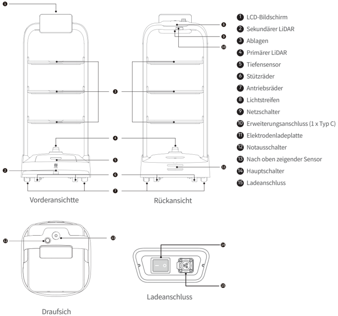
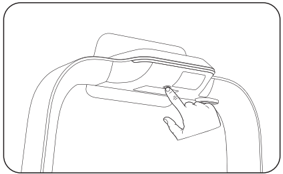
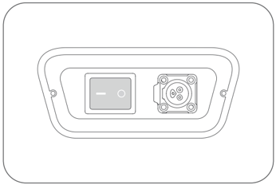

*Seite 27 (PDF-Seite 16, links)*

Copyright © 2023 Shenzhen Pudu Technology Co., Ltd. Alle Rechte vorbehalten.

Ohne die ausdrückliche schriftliche Zustimmung von Shenzhen Pudu Technology Co., Ltd. dürfen weder Organisationen noch Einzelpersonen den Inhalt dieses Benutzerhandbuchs ganz oder teilweise vervielfältigen, kopieren, transkribieren oder übersetzen oder dieses Benutzerhandbuch auf irgendeine Weise gewinnbringend verbreiten (elektronisch oder durch Fotokopieren, Aufzeichnen usw.). Die technischen Produktdaten und Informationen in diesem Benutzerhandbuch dienen nur als Referenz und können ohne weitere Ankündigung geändert werden. Sofern nicht anders angegeben, ist dieses Benutzerhandbuch nur als Bedienungsanleitung zu verstehen und stellt keine Zusicherung irgendeiner Art dar.

# 1. Sicherheitshinweise

## 1.1 Elektrische Anforderungen

- Es ist streng verboten, andere Ladegeräte als das Original-Ladegerät zum Aufladen des Roboters zu verwenden. Wenn das Ladegerät defekt ist, ersetzen Sie es so bald wie möglich.
- Laden Sie den Roboter auf, sobald weniger als 20 % verbleibende Leistung vorhanden sind. Der Betrieb bei niedrigem Akkustand über einen längeren Zeitraum verkürzt die Lebensdauer des Akkus.
- Stellen Sie sicher, dass die Versorgungsspannung dem Spannungsbereich am Ladegerät entspricht, da sonst das Ladegerät beschädigt werden kann.

## 1.2 Nutzungsanforderungen

- Während der Roboter läuft, darf die Kamera auf dem Roboter nicht blockiert werden, um eine unkontrollierte Bewegung des Roboters zu vermeiden. Halten Sie in diesem Fall die aktuelle Aufgabe an, und setzen Sie den Roboter zurück auf die richtige Route, bevor er seinen Weg wieder aufnimmt.
- Es dürfen keine Reinigungs- oder Wartungsarbeiten durchgeführt werden, solange der Roboter eingeschaltet ist.
- Stellen Sie keine Kocher mit offener Flamme oder brennbaren oder explosiven Gegenständen auf die Tabletts des Roboters.
- Nehmen Sie kein Geschirr vom Roboter und stellen Sie keine Gegenstände darauf ab, während sich der Roboter bewegt, um Sach- oder Personenschäden durch versehentliche Kollisionen zu vermeiden.
- Schieben oder tragen Sie den Roboter nicht, während er sich bewegt, um eine unkontrollierte Bewegung zu verhindern.
- Der Roboter darf nur von geschultem Fachpersonal zerlegt oder repariert werden. Im Falle einer Störung des Roboters wenden Sie sich bitte sofort an einen Techniker des technischen Kundendienstes von Shenzhen Pudu Technology Co, Ltd.
- Beachten Sie bei der Umpositionierung des Roboters die gesetzlich vorgeschriebenen Anforderungen an das maximal zulässige Gewicht pro Person. Stellen Sie sicher, dass sich der Roboter während der Umpositionierung in einer aufrechten Position befindet. Der Roboter darf nicht an den Ablagen angehoben werden.

## 1.3 Umgebungsbedingungen

- Verwenden oder laden Sie den Roboter nicht in gefährlichen Umgebungen mit hohen Temperaturen, hohem Druck oder Brand- und Explosionsgefahr, um Verletzungen oder Schäden am Produkt zu vermeiden.
- Verwenden Sie den Roboter nicht in feuchter Umgebung oder auf einem Untergrund, auf dem sich Flüssigkeiten oder zähflüssige Substanzen befinden, um Schäden am Roboter zu vermeiden.
- Verwenden Sie den Roboter nicht an Orten, an denen drahtlose Geräte ausdrücklich verboten sind, da dies andere elektronische Geräte stören oder andere Gefahren verursachen kann.
- Entsorgen Sie den Roboter und dessen Zubehör nicht im normalen Hausmüll. Bitte halten Sie sich an die örtlichen Vorschriften zur Entsorgung des Roboters und von dessen Zubehör und unterstützen Sie das Recycling.

---

*Seite 28 (PDF-Seite 16, rechts)*

# 2. Produktkomponenten

## 2.1 Übersicht

PuduBot 2 ist ein Lieferroboter für den Innenbereich mit visueller Positionierung und Navigation sowie 3D-Hindernisvermeidung. Der Roboter wird mit drei abnehmbaren und einstellbaren Metall-Ablagen geliefert, die für den Einsatz in Restaurants, Internetcafés, Hotels und Fabriken geeignet sind. Um verschiedenen Geschäftsszenarien gerecht zu werden, bietet PuduBot 2 Nutzern eine Vielzahl von Modi zur Auswahl, darunter Speisenlieferungsmodus, Rundfahrmodus, Zustellmodus, Direktmodus, Geburtstagsmodus und Sammelmodus.

## 2.2 Packliste

1×Roboter, 1×Pudubot 2 Benutzerhandbücher, 1×Qualitätszertifikat, 1×Ladegerät.

## 2.3 Erscheinungsbild und Komponenten

> *Bildbeschreibung (KI):* Mit der Abbildung können die Positionen von Sensoren (LiDAR, Tiefensensor), Rädern, Schaltern und Anschlüssen am Roboter identifiziert werden. Die Beschriftungen erklären Funktionen wie den Haupt- und Notausschalter, den Ladeanschluss sowie den Erweiterungsanschluss Typ C. Durch die verschiedenen Ansichten wird klar, wo sich welche Bauteile befinden – z. B. der LCD-Bildschirm oben vorne oder die Elektrodenladeplatte unten hinten.

*Beschriftungen:*

- **1** LCD-Bildschirm
- **2** Sekundärer LiDAR
- **3** Ablagen
- **4** Primärer LiDAR
- **5** Tiefensensor
- **6** Stützräder
- **7** Antriebsräder
- **8** Lichtstreifen
- **9** Netzschalter
- **10** Erweiterungsanschluss (1 x Typ C)
- **11** Elektrodenladeplatte
- **12** Notausschalter
- **13** Nach oben zeigender Sensor
- **14** Hauptschalter
- **15** Ladeanschluss

---

*Seite 29 (PDF-Seite 17, links)*

## 2.4 Technische Daten

| Produktfunktion | Beschreibung |
|---|---|
| Produktmodell | PDFD22 |
| Betriebsspannung | DC 23 V ~ 29,4 V |
| Leistungsaufnahme | AC 100 V ~ 240 V, 50/60 Hz |
| Ausgangsleistung | 29,4 V, 8 A |
| Batteriekapazität | 20 Ah |
| Ladezeit | ca. 3 Std. |
| Akkulaufzeit | 10 – 24 Std. |
| Gesamtgewicht | 39 kg |
| Gesamtabmessung | 580 mm×535 mm×1290 mm |
| Fahrgeschwindigkeit | 0,5 – 1,2 m/s (einstellbar) |
| Navigationsmethode | Visuelle Positionierung |
| Minimale Durchfahrbreite | 80 cm |
| Maximal überwindbare Höhe | 10 mm |
| Maximaler Steigwinkel | 5º |
| Größe der Ablagen | 520 mm×435 mm |
| Anzahl der Ablagen | 3 |
| Abstand zwischen Ablagenebenen | Einstellbar |
| Tragfähigkeit der Ablagen | Standard: 10kg/Ablage; Max.: 13kg/Ablage |
| Allgemeines Material | PC+ABS/Aluminum alloy |
| Betriebssystem | Android |
| Lautsprecherleistung | 10 W x 2 Stereo-Lautsprecher |
| Betriebsumgebung | Temperatur: 0° C bis 40° C; Luftfeuchtigkeit: ≤ 85 % RH |
| Aufbewahrungsumgebung | Temperatur: -40° C bis 65° C; Luftfeuchtigkeit: ≤ 85 % RH |
| Betriebshöhe | < 2000 m |
| Anforderungen an die Bodenoberfläche | Innenraumumgebung mit flachen, glatten Bodenoberflächen |
| IP-Schutzart | IP20 |
| Frequenzbandbereich | WLAN: 2,4G Wi-Fi: 2412–2472 MHz |
| Frequenzbandbereich | Bluetooth: 2402–2480 MHz |
| Frequenzbandbereich | 3G: B1/B8 |
| Frequenzbandbereich | 4G LTE-FDD: B1/B3/B7/B8/B20/B28 |
| Frequenzbandbereich | 4G LTE-TDD: B34/B38/B40 |
| Max. Abstrahlleistung | WLAN: 2,4G Wi-Fi: 15,55 dBm |
| Max. Abstrahlleistung | Bluetooth: BLE: 5,27 dBm; BT: 2,39 dBm |
| Max. Abstrahlleistung | 3G: WCDMA: B1: 22,49 dBm; B8: 20,90 dBm; HSDPA: B1: 20,50 dBm; B8: 21,74 dBm; HSUPA: B1: 20,43 dBm; B8: 21,57 dBm |
| Max. Abstrahlleistung | 4G LTE-FDD: B1: 19,43 dBm; B3: 22,02 dBm; B7: 18,60 dBm; B8: 21,14 dBm; B20: 21,39 dBm; B28: 21,78 dBm |
| Max. Abstrahlleistung | 4G LTE-TDD: B34: 20,10 dBm; B38: 19,51 dBm; B40: 19,18 dBm |

---

*Seite 30 (PDF-Seite 17, rechts)*

# 3. Produktanweisungen

## 3.1 Mapping-Anweisungen

PuduBot 2 kann selbstständig neue Karten erstellen. Wenn der Roboter zum ersten Mal eingeschaltet wird, können Nutzer neue Karten direkt auf dem Roboter erstellen, ohne dafür Mapping-Tools verwenden zu müssen. Vor dem Erstellen einer neuen Karte müssen sich Nutzer an den technischen Support wenden, um einen Aktivierungscode zu erhalten und einen geeigneten Startort für den Roboter auswählen, indem ein Startetikett an diesem Ort angebracht wird. Nutzer können dann den Anweisungen auf dem Bildschirm folgen, um eine Karte zu erstellen. Weitere Informationen finden Sie im PuduBot 2 Benutzerhandbuch.

## 3.2 Tastenbeschreibung

## Einschalten：

Bewegen Sie den Roboter zum Startpunkt. Halten Sie den Netzschalter eine Sekunde lang gedrückt. Der Lichtstreifen auf dem Roboter wird blau und zeigt damit an, dass der Roboter erfolgreich eingeschaltet wurde.

> *Bildbeschreibung (KI):* Ein Finger tippt auf den Bildschirm, was die Funktion zum Anhalten oder Fortsetzen der aktuellen Aufgabe veranschaulicht. Der Netzschalter befindet sich an der Oberseite des Roboters und ist für das Einschalten und Ausschalten zuständig.

## Vorsicht：

Stellen Sie sicher, dass sich der Hauptschalter in der Stellung „—" befindet, bevor Sie den Roboter starten.

> *Bildbeschreibung (KI):* Die Abbildung zeigt die Position des Netzschalters (Einschalten/Ausschalten) und des Notausschalters am Gerät. Der Netzschalter ist ein rechteckiger Schalter mit den Symbolen für Ein- und Ausschalten. Der Notaus-Schalter befindet sich rechts neben dem Netzschalter und hat eine runde Form mit vier Löchern in der Mitte. Die Abbildung hilft, die physischen Bedienelemente am Roboter zu identifizieren.
## Ausschalten：

Halten Sie den Netzschalter drei Sekunden lang gedrückt. Auf dem Bildschirm wird ein Befehl zum Herunterfahren angezeigt. Klicken Sie auf „Ausgeschaltet". Die Leuchtleiste auf dem Roboter und der Bildschirm werden ausgeschaltet, um anzuzeigen, dass der Roboter erfolgreich ausgeschaltet wurde.

## Anhalten:

Während sich der Roboter bewegt, kann die aktuelle Aufgabe durch Tippen auf den Bildschirm unterbrochen werden. Durch erneutes Tippen auf den Bildschirm wird die aktuelle Aufgabe fortgesetzt.

## Notaus:

Drücken Sie im Notfall während der Fortbewegung des Roboters den Notausschalter, um den Roboter anzuhalten. Drehen Sie den Notausschalter im Uhrzeigersinn, und befolgen Sie die Anweisungen auf dem Bildschirm, um den Betrieb des Roboters wieder aufzunehmen.

---

*Seite 31 (PDF-Seite 18, links)*

# 4. Wartung und Instandhaltung

| Zu wartendes Teil | Roboterstatus | Prüffrequenz | Wartungsmethode |
|---|---|---|---|
| Ablagen, Antriebsräder und Stützräder | Ausgeschaltet | Einmal pro Woche | Wischen Sie die Oberfläche mit einem sauberen Tuch ab. |
| Optischer Sensor, Tiefensichtsensor und LiDAR | Ausgeschaltet | Einmal pro Woche | Verwenden Sie zur Reinigung ein sauberes Tuch oder Linsenreinigungswerkzeuge. Bei plötzlicher Verschmutzung müssen Sie sofort handeln, um zu vermeiden, dass die Sensoren blockiert werden, was zu einem fehlerhaften Betrieb des Roboters führen kann. |
| Robotergehäuse | Ausgeschaltet | Einmal pro Monat | Wischen Sie die Oberfläche mit einem sauberen Tuch ab. |

# 5. Kundendienst

Shenzhen Pudu Technology Co., Ltd. verpflichtet sich, während der Garantiezeit des Produkts kostenlose Garantieleistungen zu erbringen (für verschiedene Teile des Produkts können unterschiedliche Garantiezeiten gelten). Der Kunde muss keine Gebühren für die Ersatzteile zahlen. Die Standardgebühren fallen an, wenn der Garantiezeitraum abgelaufen oder keine kostenlose Produktgarantie anwendbar ist. Kunden können die Kundendienst-Hotline anrufen, um mehr über die Kundendienstrichtlinien zu erfahren oder ein Produkt warten zu lassen. Weitere Informationen zu den Kundendienstrichtlinien erhalten Kunden in der PuduBot 2-Bedienungsanleitung.

Feedback-Methoden:

：+86 755-86952935

：techservice@pudutech.com

# 6. Compliance-Informationen

## 6.1 Informationen zur Entsorgung und zum Recycling

Die Richtlinie über Elektro- und Elektronik-Altgeräte (WEEE) zielt darauf ab, die Auswirkungen von Elektro- und Elektronikgeräten auf die Umwelt zu minimieren, indem die Wiederverwendung und das Recycling gefördert und die Menge der zu entsorgenden Elektro- und Elektronik-Altgeräte reduziert wird. Das Symbol auf diesem Produkt oder seiner Verpackung bedeutet, dass dieses Produkt am Ende seiner Lebensdauer getrennt vom normalen Hausmüll entsorgt werden muss. Beachten Sie, dass Sie dafür verantwortlich sind, elektronische Geräte in Recyclingzentren zu entsorgen, um natürliche Ressourcen zu schonen. In jedem Land gibt es eigene Sammelstellen für das Recycling von Elektro- und Elektronikgeräten. Informationen zum Recycling-Rückgabebereich erhalten Sie bei der zuständigen Abfallentsorgungsbehörde für elektrische und elektronische Geräte, bei der örtlichen Stadtverwaltung oder bei der Müllentsorgungsstelle Ihres Standorts.

Bevor Elektro- und Elektronikgeräte (EEE) in den Wertstoffkreislauf oder in Abfallsammelstellen gegeben werden, muss der Endnutzer von Geräten, die Batterien und/oder Akkumulatoren enthalten, diese Batterien und Akkumulatoren zur getrennten Sammlung entfernen.

*Ausführliche Wartungsanweisungen finden Sie in der PuduBot 2-Bedienungsanleitung.
