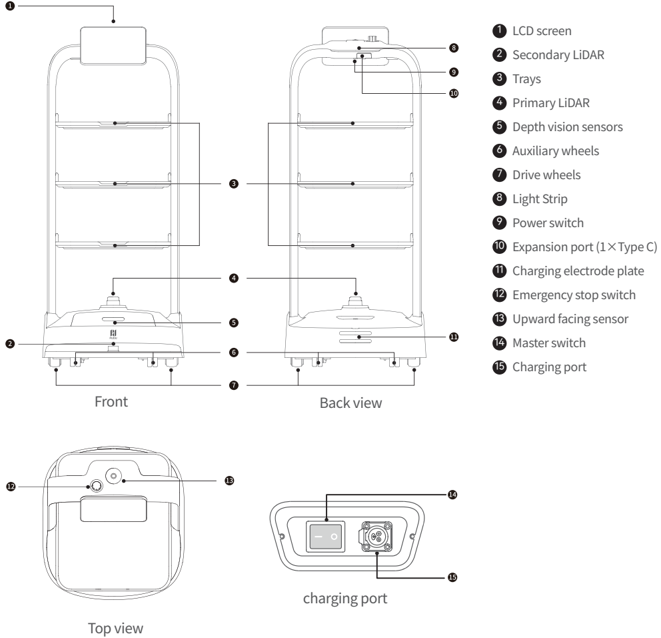
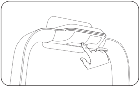
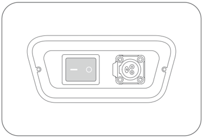

*Page 1 (PDF page 3, left)*

Copyright © 2023 Shenzhen Pudu Technology Co., Ltd. All rights reserved.

No organization or individual shall imitate, copy, transcribe or translate the contents of this user guide, in part or in full, without the express written consent of Shenzhen Pudu Technology Co., Ltd., or distribute this user guide for profit in any way (electronically or via photocopying, recording, etc.). The product specifications and information provided in this user guide are for reference only and are subject to change without further notice. Unless otherwise specified, this user guide is only intended as instructions for use, and no representation shall be deemed as a warranty of any kind.

# 1. Safety instructions

## 1.1 Electrical requirements

- It is strictly prohibited to use chargers other than the original charger to charge the robot. If the charger is found to be faulty, please replace it as soon as possible.
- Be sure to charge the robot as soon as it has less than 20% power remaining. Working at low battery levels for long periods will shorten the battery's service life.
- Make sure that the power supply voltage complies with the voltage range on the charger, otherwise the charger may be damaged.

## 1.2 Use requirements

- While the robot is moving, do not block the camera on the top of the robot, to prevent the robot from walking abnormally. If this happens, please pause the current task and push the robot back to the correct route before letting it proceed.
- Cleaning or maintenance work is prohibited while the robot is powered on.
- Do not place cookers with naked flames or flammable or explosive items on the robot's trays.
- Do not pick up or place any items while the robot is moving, to avoid property losses or personal injury caused by accidental collisions.
- Do not push or carry the robot while it is moving, to prevent it from walking abnormally.
- The robot must not be disassembled or repaired by anyone other than trained professionals. In case of any fault with the robot, please contact a technical support engineer from Shenzhen Pudu Technology Co., Ltd. immediately.
- When moving the robot, please observe the requirements on the maximum allowed weight for a single person stipulated by local laws or regulations. While the robot is being moved, please be sure to always keep it in an upright position. It is prohibited to lift the robot by the trays.

## 1.3 Environmental requirements

- Do not use or charge the robot in dangerous environments with high temperature, high pressure, or risks of flames or explosions, so as to avoid personal injury or damage to the product.
- Do not use the robot in a humid environment or in the presence of liquid or viscous substances on the ground, so as to avoid damage to the robot.
- Do not use the robot in locations where wireless devices are explicitly prohibited, as this may interfere with other electronic devices or cause other hazards.
- Do not dispose of the robot and its accessories as ordinary domestic waste. Please comply with local regulations on the disposal of the robot and its accessories and support recycling.

---

*Page 2 (PDF page 3, right)*

# 2. Product components

## 2.1 Overview

PuduBot 2 is an indoor delivery robot with visual positioning and navigation as well as 3D obstacle avoidance. The robot comes with three removable and adjustable metal trays, suitable for use in restaurants, Internet cafes, hotels and factories. To cater to different business scenarios, PuduBot 2 offers a variety of modes for users to choose from, including food delivery mode, cruise mode, delivery mode, direct mode, birthday mode and collection mode.

## 2.2 Packing List

Robot×1、PuduBot 2 User Manual×1、Quality Certificate×1、Charger×1 .

## 2.3 Appearance and Components

> *Figure description (AI):* Each number corresponds to a part name listed in the legend on the right side of the diagram. Key functional elements like charging port, power switch, emergency stop switch, and LiDAR sensors are clearly marked and located. The top view highlights the upward-facing sensor and master switch position for user interaction.

*Labels:*

- **1** LCD screen
- **2** Secondary LiDAR
- **3** Trays
- **4** Primary LiDAR
- **5** Depth vision sensors
- **6** Auxiliary wheels
- **7** Drive wheels
- **8** Light Strip
- **9** Power switch
- **10** Expansion port (1×Type C)
- **11** Charging electrode plate
- **12** Emergency stop switch
- **13** Upward facing sensor
- **14** Master switch
- **15** Charging port

---

*Page 3 (PDF page 4, left)*

# 2.4 Specifications

| Product Feature | Description |
|---|---|
| Product model | PDFD22 |
| Operating voltage | DC 23 V ~ 29.4 V |
| Power input | AC 100 V ~ 240 V, 50/60 Hz |
| Power output | 29.4 V, 8 A |
| Battery capacity | 20 Ah |
| Charging time | About 3h |
| Battery life | 10 h ~ 24 h |
| Overall weight | 39 kg |
| Overall dimensions | 580 mm × 535 mm × 1290 mm |
| Cruise speed | 0.5 ~ 1.2 m/s (adjustable) |
| Navigation method | Visual positioning |
| Minimum passing width | 80 cm |
| Maximum surmountable height | 10 mm |
| Maximum climbing angle | 5° |
| Tray size | 520 mm × 435 mm |
| Number of trays | 3 |
| Height between tray levels | (adjustable) |
| Tray supporting capacity | Rated: 10 kg/level; maximum: 13 kg/level |
| Overall material | PC+ABS/Aluminum alloy |
| Operating system | Android |
| Speaker power | 10 W × 2 stereo speaker |
| Working environment | Temperature: 0 ℃ to 40 ℃; ; humidity: ≤ 85% RH |
| Storage environment | Temperature: -40 ℃ to 65 ℃; ; humidity: ≤ 85% RH |
| Operating altitude | < 2000 m |
| Road surface requirements | Indoor environment with flat, smooth surfaces |
| IP rating | IP20 |
| Frequency band range | Wi-Fi: 2.4G Wi-Fi: 2412–2472 MHz |
| Frequency band range | Bluetooth: 2402–2480 MHz |
| Frequency band range | 3G: B1/B8 |
| Frequency band range | 4G LTE-FDD: B1/B3/B7/B8/B20/B28 |
| Frequency band range | 4G LTE-TDD: B34/B38/B40 |
| Max. transmit power | Wi-Fi: 2.4G Wi-Fi: 15.55 dBm |
| Max. transmit power | Bluetooth: BLE: 5.27 dBm; BT: 2.39 dBm |
| Max. transmit power | 3G: WCDMA: B1: 22.49 dBm; B8: 20.90 dBm; HSDPA: B1: 20.50 dBm; B8: 21.74 dBm; HSUPA: B1: 20.43 dBm; B8: 21.57 dBm |
| Max. transmit power | 4G LTE-FDD: B1: 19.43 dBm; B3: 22.02 dBm; B7: 18.60 dBm; B8: 21.14 dBm; B20: 21.39 dBm; B28: 21.78 dBm |
| Max. transmit power | 4G LTE-TDD: B34: 20.10 dBm; B38: 19.51 dBm; B40: 19.18 dBm |

---

*Page 4 (PDF page 4, right)*

# 3. Using the Product

## 3.1 Mapping instructions

PuduBot 2 can create new maps itself. When the robot is turned on for the first time, users can create new maps directly on the robot, without having to use any mapping tools. Before creating a new map, users need to contact a technical support engineer to obtain an activation code and choose a suitable location as the robot's startup location by fixing a startup label to that location. Users can then follow the on-screen prompts to create a map. For details, please refer to the PuduBot 2 User Guide.

## 3.2 Button description

## Power-on：

Move the robot to the startup location. Press and hold the power switch for 1 second, and the light strip on the top of the robot will turn blue, indicating that the robot has been successfully powered on.

> *Figure description (AI):* The figure shows a hand pressing the power switch on the robot. The image demonstrates how to pause or resume the robot's task by tapping the screen.

## Caution：

Make sure that the master switch has been turned to the "—" position before starting up the robot.

> *Figure description (AI):* The figure shows a power switch with '—' and 'O' positions. A circular connector port is located next to the power switch. The power switch is used for powering on and off the robot. The connector port is likely for charging or data connection.
## Power-off：

Press and hold the power switch for 3 seconds, and a shutdown prompt will pop up. Click "Powered off" and the light strip on the top of the robot and the screen will turn off, indicating that the robot has been successfully powered off.

## Pause:

While the robot is moving, the current task can be paused by tapping the screen. Tapping the screen again will resume the current task.

## Emergency stop:

In case of an emergency while the robot is moving, press the emergency stop switch to stop the robot. Turn the emergency stop switch clockwise and follow the on-screen prompts to resume the robot's operation.

---

*Page 5 (PDF page 5, left)*

# 4. Maintenance and Care

| Part to maintain | Robot status | Checking frequency | Maintenance method |
|---|---|---|---|
| Trays, drive wheels and auxiliary wheels | Powered off | One week | Please wipe the surface with a clean cloth. |
| Visual sensor, depth vision sensor and LiDAR | Powered off | One week | Please use a clean cloth or lens cleaning tools to clean. In case of sudden contamination, be sure to handle immediately to avoid blocked sensors, which may lead to abnormal operation of the robot. |
| Robot body | Powered off | One month | Please wipe the surface with a clean cloth. |

# 5. After-sales service

Shenzhen Pudu Technology Co., Ltd. undertakes to provide free product warranty services during the product's warranty period (different parts of the product may have different warranty periods). The customer does not need to pay any fees for the spare parts. Standard fees apply if the warranty period has expired or in cases where free product warranty is not applicable. Customers can call the after-sales service hotline to learn more about the after-sales service policy and for product maintenance, or refer to the PuduBot 2 User Guide for detailed after-sales service policies. Feedback methods:

：+86 755-86952935

：techservice@pudutech.com

# 6. Compliance information

## 6.1 Disposal and recycling information

The Waste Electrical and Electronic Equipment (WEEE) Directive aims to minimize the impact of electrical and electronic goods on the environment, by increasing re-use and recycling and by reducing the amount of WEEE going to landfill. The symbol on this product or its packaging signifies that this product must be disposed separately from ordinary household wastes at its end of life. Be aware that this is your responsibility to dispose of electronic equipment at recycling centers in order to conserve natural resources. Each country should have its collection centers for electrical and electronic equipment recycling. For information about your recycling drop off area, please contact your related electrical and electronic equipment waste management authority, your local city office, or your house hold waste disposal service.

Before placing electrical and electronic equipment (EEE) in the waste collection stream or in waste collection facilities, the end user of equipment containing batteries and/or accumulators must remove those batteries and accumulators for separate collection.

*For detailed instructions on using the robot, please refer to the PuDuBot 2 Operation Guide.

---

*Page 6 (PDF page 5, right)*

# 7. Compliance information

## 7.1 Federal Communications Commission compliance statement

The following information applies to Pudu robotic.

This equipment has been tested and found to comply with the limits for a Class B digital device, pursuant to part 15 of the FCC Rules. These limits are designed to provide reasonable protection against harmful interference in a residential installation. This equipment generates, uses and can radiate radio frequency energy and, if not installed and used in accordance with the instructions, may cause harmful interference to radio communications. However, there is no guarantee that interference will not occur in a particular installation. If this equipment does cause harmful interference to radio or television reception, which can be determined by turning the equipment off and on, the user is encouraged to try to correct the interference by one or more of the following measures:

- Reorient or relocate the receiving antenna.
- Increase the separation between the equipment and receiver.
- Connect the equipment into an outlet on a circuit different from that to which the receiver is connected.
- Consult the dealer or an experienced radio/TV technician for help.

This device complies with Part 15 of the FCC rules. Operation is subject to the following two conditions:

- This device may not cause harmful interference.
- This device must accept any interference received, including interference that may cause undesired operation.

## 7.2 Industry Canada compliance statement

This device complies with Industry Canada licence-exempt RSS standard(s). Operation is subject to the following two conditions:

- This device may not cause interference.
- This device must accept any interference, including interference that may cause undesired operation of the device.
