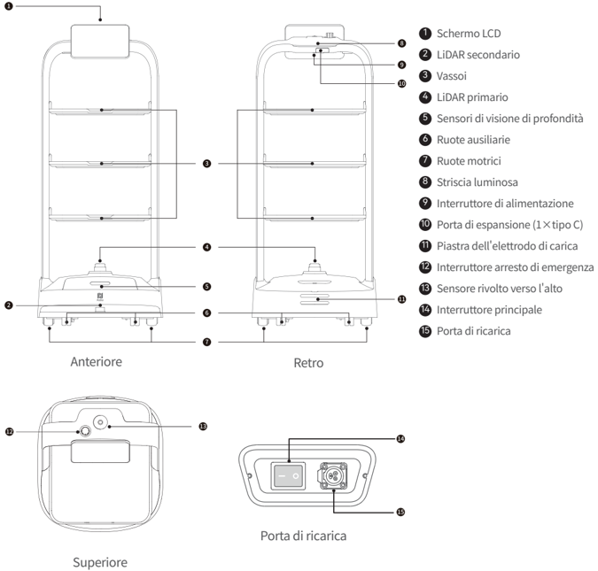
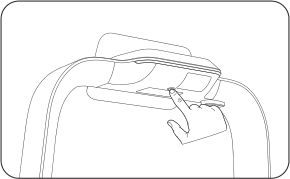
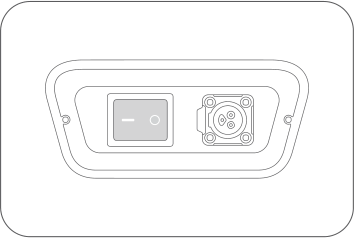

*Pagina 43 (pagina PDF 24, sinistra)*

Copyright © 2023Shenzhen Pudu Technology Co., Ltd. Tutti i diritti riservati.

Nessuna organizzazione o persona fisica potrà imitare, copiare, trascrivere o tradurre, in parte o per intero, il contenuto della presente guida per l'utente senza l'esplicito consenso scritto di Shenzhen Pudu Technology Co., Ltd., o distribuire la presente guida per l'utente a scopo di lucro in qualsiasi modo (elettronicamente o mediante fotocopiatura, registrazione, ecc.). Le specifiche del prodotto e le informazioni fornite nella presente guida per l'utente sono riportate esclusivamente a titolo di riferimento e sono soggette a modifiche senza ulteriore avviso. Se non diversamente specificato, la presente guida per l'utente è da intendersi esclusivamente come istruzioni per l'uso e nessuna dichiarazione è da considerarsi come garanzia di alcun tipo.

# 1. Istruzioni di sicurezza

## 1.1 Requisiti elettrici

- È severamente vietato utilizzare caricabatterie diversi da quelli originali per caricare il robot. Se il caricatore risulta danneggiato, sostituirlo tempestivamente.
- Assicurarsi di caricare il robot non appena la carica residua è inferiore al 20%. Il funzionamento con livelli della batteria bassi per lunghi periodi riduce la durata della batteria stessa.
- Assicurarsi che la tensione dell'alimentazione sia conforme alla gamma di tensione sul caricatore per evitare di danneggiarlo.

## 1.2 Requisiti d'uso

- Mentre il robot è in movimento, non trattenere la videocamera posta du di esso per evitare spostamenti anomali. Se ciò avviene, sospendere l'attività corrente e riportare il robot sul percorso corretto prima di farlo proseguire.
- È vietato eseguire interventi di pulizia o manutenzione quando il robot è acceso.
- Non collocare piastre con fiamme libere o oggetti infiammabili o esplosivi sui vassoi del robot.
- Non sollevare o posizionare oggetti mentre il robot è in movimento per evitare la perdita di oggetti o lesioni personali causate da collisioni accidentali.
- Non spingere o trasportare il robot mentre è in movimento per evitare spostamenti anomali.
- Il robot deve essere smontato o riparato esclusivamente da professionisti qualificati. In caso di guasti al robot, contattare immediatamente un esperto del supporto tecnico di Shenzhen Pudu Technology Co., Ltd.
- Quando si sposta il robot, rispettare i requisiti sul peso massimo consentito per una sola persona, come stabilito dalle leggi o dalle normative locali. Mentre il robot è in movimento, assicurarsi di tenerlo sempre in posizione verticale. È vietato sollevare il robot tramite i vassoi.

## 1.3 Requisiti ambientali

- Non utilizzare o caricare il robot in ambienti pericolosi con temperature e pressioni elevate o con rischio di fiamme o esplosioni, per evitare lesioni personali o danni al prodotto.
- Non utilizzare il robot in ambienti umidi o in presenza di sostanze liquide o viscose sul pavimento, per evitare di danneggiarlo.
- Non utilizzare il robot in luoghi in cui sono esplicitamente vietati i dispositivi wireless che potrebbero interferire con altri dispositivi elettronici o causare altri pericoli.
- Non smaltite il robot e i suoi accessori come normali rifiuti domestici. Attenersi alle normative locali riguardo allo smaltimento del robot e dei suoi accessori e favorire il riciclo.

---

*Pagina 44 (pagina PDF 24, destra)*

# 2. Componenti del prodotto

## 2.1 Panoramica

PuduBot 2 è un robot per servizi di consegna per interno con posizionamento e navigazione visivi, nonché dotato di tecnologia 3D per evitare ostacoli. Il robot è dotato di tre vassoi in metallo rimovibili e regolabili, adatti per l'uso in ristoranti, Internet café, hotel e fabbriche. Per soddisfare i diversi scenari aziendali, PuduBot 2 offre agli utenti diverse modalità tra cui scegliere, quali modalità di consegna del cibo, modalità di percorso, modalità di assistenza, modalità compleanno e modalità di raccolta.

## 2.2 Contenuto della confezione

Robot×1, Manuale utente PurduBot 2×1, Certificato di qualità×1, Caricabatterie×1.

## 2.3 Aspetto e componenti

> *Descrizione della figura (IA):* La figura mostra le posizioni dei componenti del robot PuduBot 2 su quattro viste: anteriore, retro, superiore e porta di ricarica.

*Etichette:*

- **1** Schermo LCD
- **2** LiDAR secondario
- **3** Vassoi
- **4** LiDAR primario
- **5** Sensori di visione di profondità
- **6** Ruote ausiliarie
- **7** Ruote motrici
- **8** Striscia luminosa
- **9** Interruttore di alimentazione
- **10** Porta di espansione (1×tipo C)
- **11** Piastra dell'elettrodo di carica
- **12** Interruttore arresto di emergenza
- **13** Sensore rivolto verso l'alto
- **14** Interruttore principale
- **15** Porta di ricarica

---

*Pagina 45 (pagina PDF 25, sinistra)*

# 2.4 Specifiche tecniche

| Caratteristiche del prodotto | Descrizione |
|---|---|
| Modello del prodotto | PDFD22 |
| Tensione d'esercizio | CC 23 V ~ 29,4 V |
| Potenza assorbita | CA 100 V ~ 240 V, 50/60 Hz |
| Potenza in uscita | 29,4 V, 8 A |
| Capacità della batteria | 20 Ah |
| Tempo di ricarica | Circa 3 h |
| Durata della batteria | 10 h ~ 24 h |
| Peso complessivo | 39 kg |
| Specifiche dello schermo | Schermo LCD da 10.1" |
| Dimensioni complessive | 580 mm × 535 mm × 1290 mm |
| Velocità | 0,5 ~ 1,2 m/s (regolabile) |
| Metodo di navigazione | Posizionamento visivo |
| Larghezza minima di passaggio | 80 cm |
| Altezza massima superabile | 10 mm |
| Pendenza di salita massimo | 5° |
| Formato del vassoio | 520 mm × 435 mm |
| Numero di vassoi | 3 |
| Altezza tra i livelli del vassoio | (regolabile) |
| Capacità di supporto vassoio | Portata: 10 kg/livello; massimo: 13 kg/livello |
| Materiale complessivo | PC+ABS/Lega di alluminio |
| Sistema operativo | Android |
| Potenza degli altoparlanti | Altoparlante stereo da 10 |
| Ambiente di lavoro | Temperatura: Da 0 ℃ a 40 ℃; ; umidità: ≤ ≤85% UR |
| Ambiente di conservazione | Temperatura: Da -40 ℃ a 65 ℃; ; umidità: ≤ ≤85% UR |
| Altitudine operativa | < 2000 m. |
| Requisiti di superficie | Ambiente interno con superfici piatte e lisce |
| Classificazione IP | IP20 |
| Banda di frequenza | Wi-Fi: Wi-Fi 2,4 G: 2412–2472 MHz |
| Banda di frequenza | Bluetooth: 2402–2480 MHz |
| Banda di frequenza | 3G: B1/B8 |
| Banda di frequenza | 4G LTE-FDD: B1/B3/B7/B8/B20/B28 |
| Banda di frequenza | 4G LTE-TDD: B34/B38/B40 |
| Massima potenza in trasmissione | Wi-Fi: 2,4G Wi-Fi: 15,55 dBm |
| Massima potenza in trasmissione | Bluetooth: BLE: 5,27 dBm; BT: 2,39 dBm |
| Massima potenza in trasmissione | 3G: WCDMA: B1: 22,49 dBm; B8: 20,90 dBm; HSDPA: B1: 20,50 dBm; B8: 21,74 dBm; HSUPA: B1: 20,43 dBm; B8: 21,57 dBm |
| Massima potenza in trasmissione | 4G LTE-FDD: B1: 19,43 dBm; B3: 22,02 dBm; B7: 18,60 dBm; B8: 21,14 dBm; B20: 21,39 dBm; B28: 21,78 dBm |
| Massima potenza in trasmissione | 4G LTE-TDD: B34: 20,10 dBm; B38: 19,51 dBm; B40: 19,18 dBm |

---

*Pagina 46 (pagina PDF 25, destra)*

# 3. Istruzioni per il prodotto

## 3.1 Istruzioni per la mappatura

PuduBot 2 può creare nuove mappe per conto suo. Quando il robot viene acceso per la prima volta, gli utenti possono creare nuove mappe direttamente sul robot, senza dover utilizzare strumenti di mappatura. Prima di creare una nuova mappa, gli utenti devono contattare un tecnico del supporto tecnico per ottenere un codice di attivazione e scegliere una posizione adatta come posizione di partenza del robot fissando un'etichetta di avvio in quella posizione. Gli utenti possono quindi seguire le istruzioni visualizzate sullo schermo per creare una mappa. Per istruzioni più dettagliate, fare riferimento alla guida per l'utente di PuduBot 2.

## 3.2 Descrizione dei pulsanti

### Accensione ：

Spostare il robot nella posizione di partenza. Tenere premuto l'interruttore di accensione per 1 secondo; la striscia luminosa posta

sopra al robot diventa blu, ad indicare la corretta accensione.

> *Descrizione della figura (IA):* La figura mostra la posizione dell'interruttore di accensione sul robot. L'immagine illustra come tenere premuto l'interruttore per accendere o spegnere il dispositivo. È visibile la striscia luminosa sopra il robot, che indica lo stato di alimentazione. La figura aiuta a identificare il pulsante da premere durante le procedure di avvio e spegnimento.
### Attenzione：

Assicurarsi che l'interruttore principale sia stato ruotato in posizione "—" prima di avviare il robot.

> *Descrizione della figura (IA):* La figura mostra la posizione dell'interruttore di accensione/spegnimento e del pulsante di arresto di emergenza sul pannello laterale del robot. L'interruttore principale deve essere ruotato in posizione "—" (spento) prima di avviare il robot, come indicato nel testo. La figura aiuta l'utente a identificare fisicamente i controlli menzionati nelle istruzioni: accensione, spegnimento e arresto di emergenza.
### Spegnimento：

Tenere premuto l'interruttore di accensione per 3 secondi; verrà visualizzato un messaggio di spegnimento. Fare clic su "Spento" (Powered off) e la striscia luminosa sulla parte superiore del robot e lo schermo si spengono, a indicare che il robot è stato spento correttamente.

### Pausa:

Mentre il robot è in movimento, è possibile mettere in pausa l'attività corrente toccando lo schermo. Toccare nuovamente lo schermo per riprenderla.

### Arresto di emergenza:

Se si verifica una situazione di emergenza mentre il robot è in movimento, premere l'interruttore di arresto di emergenza per fermarlo. Ruotare l'interruttore di arresto di emergenza in senso orario e seguire le istruzioni visualizzate sullo schermo per riprendere il funzionamento del robot.

---

*Pagina 47 (pagina PDF 26, sinistra)*

# 4. Manutenzione e assistenza

| Parte da sottoporre a manutenzione | Stato del robot | Verifica della frequenza | Metodo di manutenzione |
|---|---|---|---|
| Vassoi, ruote motrici e ruote ausiliarie | Spento | Una settimana | Pulire la superficie con un panno pulito. |
| Sensore visivo, sensore di visione di profondità e LiDAR | Spento | Una settimana | Per la pulizia, utilizzare un panno pulito o strumenti per la pulizia delle lenti. In caso di contaminazione improvvisa, rimuovere immediatamente lo sporco per evitare l'ostruzione dei sensori, che potrebbe causare un funzionamento anomalo del robot. |
| Corpo del robot | Spento | Un mese | Pulire la superficie con un panno pulito. |

# 5. Assistenza post-vendita

Shenzhen Pudu Technology Co., Ltd. Si impegna a fornire gratuitamente servizi di garanzia sui prodotti durante il periodo di copertura (le diverse parti del prodotto possono avere periodi di garanzia differenti). Il cliente non è tenuto a pagare alcun costo per i pezzi di ricambio. Le tariffe standard si applicano se il periodo di garanzia è scaduto o nei casi in cui la garanzia del prodotto gratuito non è applicabile. I clienti possono contattare il servizio di assistenza post-vendita per maggiori informazioni sulla politica del servizio post-vendita e sulla manutenzione del prodotto, oppure consultare la guida per l'utente di PuduBot 2 per informazioni dettagliate in merito.

Metodi di feedback:

：+86 755-86952935

：techservice@pudutech.com

# 6. Informazioni sulla conformità

## 6.1 Informazioni sullo smaltimento e sul riciclo

La direttiva RAEE (rifiuti di apparecchiature elettriche ed elettroniche) ha lo scopo di ridurre al minimo l'impatto delle apparecchiature elettriche ed elettroniche sull'ambiente, aumentando il riutilizzo e il riciclo e riducendo la presenza di RAEE nelle discariche. Il simbolo su questo prodotto o sulla sua confezione indica che deve essere smaltito separatamente dai normali rifiuti domestici al termine del suo ciclo di vita. Tenere presente che è responsabilità dell'utente smaltire le apparecchiature elettroniche nei centri di riciclo al fine di preservare le risorse naturali. Ogni paese deve disporre dei propri centri di raccolta per il riciclo delle apparecchiature elettriche ed elettroniche. Per informazioni sui punti di raccolta per il riciclo, contattare l'autorità competente per la gestione dei rifiuti di apparecchiature elettriche ed elettroniche, il comune di residenza o il servizio di smaltimento dei rifiuti domestici.

Prima di inserire l'apparecchiatura elettrica ed elettronica (EEE) nel circolo o nelle strutture per la raccolta differenziata, l'utente finale deve rimuovere eventuali batterie e/o accumulatori presenti per la raccolta separata.

*Per istruzioni dettagliate sulla manutenzione, fare riferimento alla guida per l'utente di PuduBot 2.
